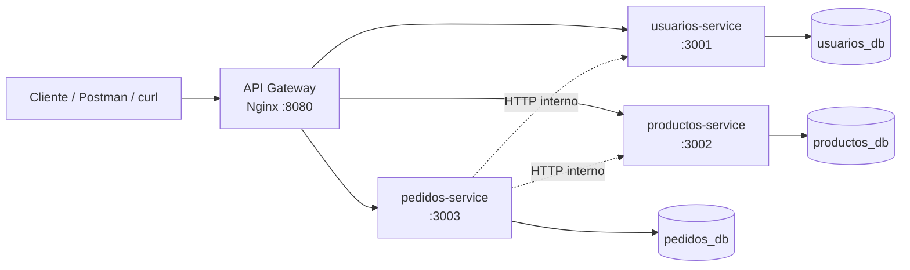

# 🛒 Tienda con Microservicios

Backend de una tienda en línea dividido en **3 microservicios independientes** que se comunican entre sí por HTTP, detrás de un **API Gateway (Nginx)** y orquestados con **Docker Compose**.


> Proyecto de portafolio para practicar arquitectura de microservicios, autenticación con JWT y contenedores.

## Arquitectura



| Servicio | Responsabilidad | Base de datos |
|---|---|---|
| **usuarios-service** | Registro, login, emisión de JWT | `usuarios_db` |
| **productos-service** | Catálogo, CRUD de productos (admin), control de stock | `productos_db` |
| **pedidos-service** | Crear y consultar pedidos; coordina a los otros dos | `pedidos_db` |
| **gateway** (Nginx) | Único punto de entrada público (puerto 8080) | — |

Cada servicio tiene **su propia base de datos** (las tres viven en un mismo contenedor de PostgreSQL, pero no comparten tablas).

## Tecnologías

Node.js 20 · Express · PostgreSQL 16 · JWT (jsonwebtoken) · bcrypt · Nginx · Docker · Docker Compose · GitHub Actions

## Cómo ejecutarlo

Necesitas [Docker](https://www.docker.com/) con Docker Compose.

```bash
git clone https://github.com/TRUEBASS33/tienda-microservicios.git
cd tienda-microservicios

# Opcional: personalizar secretos y contraseñas
cp .env.example .env

docker compose up --build
```

Cuando termine de arrancar, la API estará en **http://localhost:8080**.

Para comprobar que todo funciona de punta a punta:

```bash
./scripts/smoke-test.sh
```

Para apagar todo (y borrar los datos): `docker compose down -v`

> Si no creas `.env`, se usan valores por defecto **solo para desarrollo**. El administrador inicial es `admin@tienda.com` / `admin123`. Cámbialo en `.env` si vas a desplegarlo.

## Endpoints

Todos pasan por el gateway: `http://localhost:8080`

| Método | Ruta | Acceso | Descripción |
|---|---|---|---|
| POST | `/auth/registro` | Público | Crea un cliente y devuelve un token |
| POST | `/auth/login` | Público | Devuelve un token JWT |
| GET | `/usuarios/me` | Token | Datos del usuario autenticado |
| GET | `/productos` | Público | Lista de productos |
| GET | `/productos/:id` | Público | Detalle de un producto |
| POST | `/productos` | Admin | Crea un producto |
| PUT | `/productos/:id` | Admin | Actualiza un producto |
| DELETE | `/productos/:id` | Admin | Elimina un producto |
| POST | `/pedidos` | Token | Crea un pedido (descuenta stock) |
| GET | `/pedidos` | Token | Tus pedidos (el admin ve todos) |
| GET | `/pedidos/:id` | Token | Detalle de un pedido con sus items |

### Ejemplo rápido

```bash
# 1. Registrarte
curl -X POST http://localhost:8080/auth/registro \
  -H "Content-Type: application/json" \
  -d '{"nombre":"Ana","email":"ana@correo.com","password":"secreto123"}'

# 2. Guardar el token que devuelve
TOKEN="pega_aqui_el_token"

# 3. Ver productos
curl http://localhost:8080/productos

# 4. Hacer un pedido
curl -X POST http://localhost:8080/pedidos \
  -H "Authorization: Bearer $TOKEN" \
  -H "Content-Type: application/json" \
  -d '{"items":[{"producto_id":1,"cantidad":2},{"producto_id":2,"cantidad":1}]}'
```

## Decisiones de diseño

- **Una base de datos por servicio.** Los servicios no leen las tablas de otros; se piden los datos por HTTP. Así se pueden cambiar o escalar por separado.
- **Rutas internas (`/internal/*`).** `pedidos-service` llama a `usuarios-service` y `productos-service` con una clave compartida (`x-internal-key`). El gateway **no** expone esas rutas, por lo que desde fuera responden 404.
- **Stock atómico.** El descuento se hace con un único `UPDATE ... WHERE stock >= cantidad`, así dos pedidos simultáneos no pueden dejar el stock en negativo.
- **Compensación ante fallos (patrón saga simplificado).** Si un pedido tiene varios productos y uno falla (sin stock, servicio caído), se **repone** el stock de los que ya se habían descontado.
- **Precio congelado.** El pedido guarda nombre y precio del producto al momento de la compra, aunque luego cambie el catálogo.
- **Timeouts** de 5 s en las llamadas entre servicios, para no quedarse colgado si otro servicio no responde.
- **Roles.** Cualquiera que se registra es `cliente`; el único `admin` se crea desde variables de entorno.

## Estructura

```
tienda-microservicios/
├── docker-compose.yml
├── .env.example
├── db/init.sql                 # crea las 3 bases de datos
├── gateway/nginx.conf          # enrutamiento
├── usuarios-service/
├── productos-service/
├── pedidos-service/
├── scripts/smoke-test.sh       # prueba de punta a punta con curl
└── .github/workflows/ci.yml    # levanta todo y corre la prueba en cada push
```

## Posibles mejoras

- [ ] Pruebas unitarias y de integración (Jest + Supertest)
- [ ] Documentación OpenAPI / Swagger
- [ ] Mensajería asíncrona (RabbitMQ o Kafka) en lugar de llamadas HTTP síncronas
- [ ] Reintentos y *circuit breaker* entre servicios
- [ ] Logs centralizados y métricas (Prometheus + Grafana)
- [ ] Rate limiting en el gateway
- [ ] Frontend en React o Vue

## Autor

**Brayan Truebas** · Estudiante de Ingeniería de Sistemas · [LinkedIn](https://linkedin.com/in/brayan-truebas) · [GitHub](https://github.com/TRUEBASS33)
